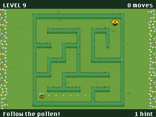

# Bee Amazed

Guide a bee through mazes that get harder with each level.

## Usage

Press **Select** to start, then use the directional controls to guide the bee
through the maze to the flower. Press **Select** again after finishing a level
to continue to the next maze. Tap a direction to move one step, or hold it
to keep moving after a short delay. Turns respond immediately.

The top bar shows your level and successful steps; the bottom bar shows how
many hints you used. The completion card summarizes both counts. They reset
for each new maze. Mazes grow until the tiles reach their minimum readable
size, then keep generating new layouts at that size.

Stuck in a dead end? Press **Select** while playing to reveal up to six steps
of golden pollen along the shortest path to the flower. The hint disappears
after 2.5 seconds or when you move, so you can keep exploring on your own.
Hints work from your current position, including along paths you have already
walked, and do not change your trail or skip a level.

No extra hardware or network access is required.

