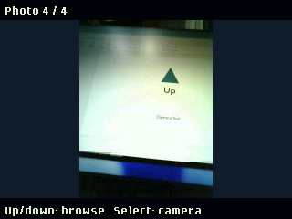

# Camera (2026 firmware only)

Use the badge as a live viewfinder and shutter for a Wi-Fi ESP32-CAM, then review the photos you take.

Live Wi-Fi viewfinder and shutter for a diymore ESP32-CAM with OV2640.
Select slides in the 3D Mona portrait and starts an animated three-second
countdown. The screen turns white during full-resolution capture/SD saving,
then freezes on the saved photo in the same clean layout as the gallery.
Select again resumes live view. Up/Down browses the last 15 compact
photo copies stored on the badge.
Once paired, the camera's white flash LED illuminates new full-resolution captures
only; it stays off during live preview and review. An unpaired camera instead
gives a faint blink every two seconds during its three-minute first-pairing window.
The indicator stops when paired or when that window expires.
Left/Right changes rotation in 90-degree steps; the setting persists and new
SD photos carry matching EXIF orientation metadata.

The new companion uses BLE for first-use pairing and Wi-Fi credential refresh.
First use shows **Connect new camera** without starting Bluetooth or showing an
error; press Select to begin discovery. Choose the camera with Select and keep
the badge nearby. Genuine Bluetooth conflicts are reported only when connecting.
No setup code or `PAIRING.TXT` is needed. First pairing must start within three
minutes of camera power-on; power-cycle the camera if that window expires.
The app maintains its private `/camera_config.json` itself. Existing pairings
are preserved and reconnect without the proximity gate. Update old camera
firmware before first pairing with this app.
Install all four Python files, `icon.png`, and the two runtime PNGs in `assets/`.
The launcher icon is Pictogrammers' MDI **camera**; connection/pairing screens
use MDI **camera-wireless** and large, rounded `font.ziplock` text with no
duplicate header message. Live view has no LIVE label or control hints;
photo review shows just its photo counter. SD warnings and errors remain visible.
Back can cancel the countdown before a capture is started; repeated Select,
rotation and gallery inputs are ignored during countdown/capture.

Returning from a photo or gallery reuses the verified Wi-Fi connection instead
of pairing again. App startup tries the saved Wi-Fi credentials first; if they
are stale, BLE refreshes them by connecting directly to the remembered camera
address. Discovery is the fallback, not the normal reconnect path. On the
attached hardware, photo-to-live resume took 262 ms and cached startup about
3.7 seconds. Select still resumes first; press Select again to take another photo.

Real-hardware verification covers code-free BLE pairing with the generous
-70 dBm median cutoff, automatic reconnection after camera restart, live preview,
two full-resolution SD captures, exact saved thumbnails, idempotent retries,
frozen review, and the badge gallery. USB cannot bypass first enrollment.
Pairing uses application-level SRP key agreement
with a public proximity-gated token, not native Bluetooth bonding or a private
password. RSSI cannot prove distance or ownership and does not prevent an active
attacker or relay during first enrollment. Pair in a trusted setting; the design
remains unaudited.
The pre-BLE Wi-Fi implementation is preserved in commit `7032183`.
See [setup, power requirements, controls, and recovery](../../../esp32-cam/README.md).
This app uses the October 2026 `badge`, `screen`, `image`, `rect`, and logical
button APIs supplied by Badgeware, not the older 2025 simulator.

## Agent handoff: app and UX iteration

The app directory is **`badge/apps/camera/`**, installed as
**`/system/apps/camera/`**. **`esp32-cam/`** is the separate companion firmware
project, not the badge app name. Do not rename either when deploying.

| File | Responsibility |
| --- | --- |
| `__init__.py` | `CameraApp` state machine, buttons, rendering, BLE-to-Wi-Fi handoff |
| `camera_core.py` | Bounded nonblocking HTTP, JPEG validation/EXIF, atomic last-15 cache |
| `camera_ble.py` | BLE discovery and paginated RPC; copies callback data before queuing |
| `camera_pairing.py` | Proximity TOFU key agreement, credential verification/decryption, config persistence |
| `icon.png` | 24 x 24 launcher icon |
| `camera_launcher_icon.py` | MDI contours for launchers with a hardcoded vector icon registry |
| `assets/camera-wireless.png` | Connection-screen MDI pictogram |
| `assets/mona.png` | Transparent crop of the repository's existing 3D Mona portrait |
| `assets/*.svg`, `assets/NOTICE.txt`, `assets/LICENSE-MDI.txt` | Icon sources and Apache-2.0 attribution; not needed on the device |
| `screenshot.png` | Documentation photo only; do not copy to the badge |

For presentation-only changes, edit `__init__.py`; normally no ESP32 rebuild or
reflash is required. Preserve Select capture/resume, Up/Down gallery, Left/Right
rotation, Back exit, pending-capture retry IDs, and stored photo orientation.
Do not erase `/camera_config.json` or `/state/camera/` to test a layout change.
The camera and badge may already be paired; first-use setup is not an upgrade step.

### Verified firmware APIs and pitfalls

- The attached device uses October 2026 Badgeware, not the older 2025 API
  documented elsewhere on this branch. `badge`, `screen`, `image`, `rect`,
  `mat3`, `brush`, `color`, `font`, `run`, and logical button constants are
  provided by the runtime. **Do not `import badge`.**
- `badge.mode(HIRES | VSYNC)` selects 320 x 240. The photo fit remains in the
  y=22..217 region; the live view no longer draws header/footer text.
  `run(app.update)` performs
  display updates and button polling; returning `False` exits the app.
- `image.load(jpeg_bytes, 320, 240)` decodes from memory. Use
  `screen.blit(frame, rect(...))`, not the old multi-coordinate blit signature.
- Preserve the image-brush transform order in `prepare_frame`: translate to
  display centre, scale, rotate, then translate by negative half-image size.
  Reversing it previously produced a split/wrapped image. Keep the source image
  alive while its brush is used. Run `rotation_hardware_probe.py` after changes.
- **Copy every BLE callback tuple before returning**, not just memoryviews.
  This build frees synchronous callback argument tuples on return. Queuing
  numeric-only tuples by reference caused native crashes and USB disappearance.
  `tuple(data)` may return the original tuple; construct a fresh tuple explicitly.
- Close BLE before joining camera Wi-Fi. Remembered-camera credentials require
  authentication; never expose them via an unauthenticated read. First pairing
  is deliberately proximity-based TOFU, not native Bluetooth bonding.
- Real hardware is required for display, BLE, and JPEG-decoder verification;
  the 2025 simulator and desktop unit tests cannot establish those behaviors.

### Deploy and check

Follow the [exact macOS deployment commands](../../../esp32-cam/README.md#agent-deployment-checklist-macos).
Only the four Python files, icon, and two runtime asset PNGs belong on the badge.
Do not copy the SVGs, license, or documentation onto it. `/system` is read-only
through the normal REPL: use mass storage for persistent app updates, then eject.
Host-mounted files and `/camera_app_test.py` are test scaffolding, not installation.

From the repository root:

```sh
.venv/bin/python -m unittest discover -s esp32-cam/tests -p 'test_*.py'
mpremote connect <badge-port> run esp32-cam/tests/rotation_hardware_probe.py
mpremote connect <badge-port> run esp32-cam/tests/real_hardware_probe.py
mpremote connect <badge-port> run esp32-cam/tests/connection_hardware_probe.py
mpremote connect <badge-port> run esp32-cam/tests/ui_hardware_probe.py
```

The real hardware probe takes two actual SD photos and adds them to the badge
gallery; it is not read-only. It checks preview, capture dimensions, saved
thumbnail equality, frozen review, idempotent retries, and gallery navigation.
After testing, hard-reset the badge and confirm USB reappears; leave it in the
normal launcher, not a stopped development REPL. For native-risk changes use
the watchdog-protected BLE probes described in the companion README.
The connection probe also takes two actual photos, times resuming preview,
and asserts that neither Wi-Fi association nor BLE provisioning is repeated.
Its reboot and stale-address scenarios are documented in the companion README.
The UI probe takes one actual SD photo, checks all countdown numbers, native
font/icon drawing, a white shutter framebuffer, and clean live/review/gallery
labels. The three-second delay applies only to new user-triggered photos;
recovering an unfinished capture skips the countdown and retains its ID.

MDI assets are Apache-2.0 licensed; see `assets/NOTICE.txt` and
`assets/LICENSE-MDI.txt`. The fallback Mona asset is cropped from the existing
`badge/apps/gallery/images/mona.png` artwork, with its blue backdrop removed.
On firmware with the current 3D launcher, the countdown reuses
`/system/apps/menu/mona.mpy`'s shared renderer and `mona_menu.p3d`, including
its tilt-aware pose and slide-up animation. Older launchers use the portrait
fallback and log that the native renderer is unavailable.

The current 3D menu ignores app PNG icons and uses `menu/icons.mpy`'s `ICONS`
registry. For that launcher only, copy `camera_launcher_icon.py` into
`/system/apps/menu/` and add these lines after `from icons import ICONS` in its
existing `app.py` (preserve all other menu code):

```python
from camera_launcher_icon import CONTOURS as CAMERA_CONTOURS
ICONS["camera"] = CAMERA_CONTOURS
```

Hard-reset afterwards to rebuild the shared tile cache. PNG-based launchers
need only the app's `icon.png`, not this registry integration.


