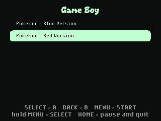

# Game Boy

Play your own original Game Boy games, such as Pokémon Red and Blue, on the badge.

The app runs [Peanut-GB](https://github.com/deltabeard/Peanut-GB), a Game Boy
emulator written in C, as a compiled MicroPython native module (`gbcore.mpy`).
Games run at full speed, scaled 1.5x to fill the screen, with Game Boy Color
style colours. The badge has no speaker, so there is no sound.

## Adding games

No games are included. Use game files (ROMs) that you have dumped from
cartridges you own.

1. Put the badge in USB Disk Mode (open **Mass Storage**, or double-tap RESET).
2. Copy your `.gb` files into `apps/game_boy/roms/` on the `BADGER` drive.
3. Eject the drive and open **Game Boy** from the menu.

If there is one game, it starts straight away; with several, pick one from the
list. Each game is a little over 1 MB for Pokémon Red/Blue/Yellow, and the
badge has room for several.

Original Game Boy games and dual-mode games (black cartridges, such as Pokémon
Gold and Silver) work. Game Boy Color-only games (clear cartridges, such as
Pokémon Crystal) do not.

## Controls

| Badge | Game Boy |
| --- | --- |
| Direction buttons or touch pad | D-pad |
| SELECT | A |
| BACK | B |
| MENU (tap) | START |
| MENU (hold) | SELECT |
| HOME | Pause menu |

The pause menu changes the colours (Game Boy Color, original green, grey), the
pixel style (sharp, smooth, original size) and the speed (normal or 2x fast
forward). Choose **Save and quit** to return to the badge menu.

## Saves

Battery saves (for example, saving in Pokémon) are written to
`/state/game_boy/<game>.sav` on the badge about a second after the game
writes them; **SAVED** flashes in the corner. To bring a save from another
emulator, copy it next to the game as `roms/<same name as the game>.sav`; the
app loads it the first time the game starts.

## Rebuilding the emulator core

`gbcore.mpy` is built from [`tools/gameboy/`](../../../tools/gameboy/). See
that README to rebuild it after changing the C code or the firmware's
MicroPython version.
