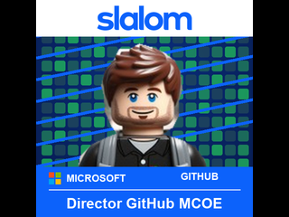

# LinkedIn photo

LinkedIn photo rotates local or optionally downloaded photo batches on a GitHub Universe 2026 badge.



## Usage

Open **linkedin_photo** from the launcher. Photos advance every **five seconds**
and loop through every PNG in `assets/`, in filename order. A single photo
stays on screen. Each photo fills as much of the 320x240 display as possible,
centered on black without stretching or cropping.

- LEFT / RIGHT: previous / next photo, wrapping at either end.
- SELECT: pause / resume; a small status strip shows the paused slide number.
- MENU: toggle help; BACK: close help.
- HOME: return to the launcher.
- DOWN: refresh the configured URL batch (when enabled).

Help suspends automatic rotation. Browsing works even while paused and resets
the five-second timer. Pausing, closing help, or resuming starts a fresh interval.
The firmware handles upside-down orientation and logical buttons.

Local playback needs no Wi-Fi, LinkedIn login, credentials, or extra hardware.
Networking is disabled by default. The optional batch URL downloads prepared
photos from your chosen server; it does not connect to LinkedIn or generate images.

Both supplied photos are bundled: `assets/photo.png` is the portrait graphic
with its outer white margins removed, and `assets/jonlego.png` is the new LEGO
portrait. Both are 240x240 RGB PNGs. The whole square image remains visible,
with black bars on either side of the screen.

The collection also includes nine locally composited Microsoft- and
GitHub-themed LEGO portrait edits (`01-microsoft-builder.png` through
`09-microsoft-build.png`). Together with `jonlego.png`, that makes ten LEGO
portraits. An additional `10-slalom-director-github-mcoe.png` portrait includes
Slalom's logo, blue theme and the label "Director GitHub MCOE", bringing the
collection to eleven LEGO portraits and twelve slides including `photo.png`.
The Slalom logo comes from the
[official Slalom logo asset](https://s7d9.scene7.com/is/image/slalom/slalom-logo-blue-1500x400);
the blue `#0C62FB` matches their
[official SVG](https://www.slalom.com/content/dam/slalom/brand-library/logos/slalom-logos/slalom-logo-blue-RGB.svg).
These are illustrated edits of the supplied LEGO portrait, not
new AI-generated photographs; the face is preserved across each composition.

## Optional remote batch URL

Edit this app's `config.json` before installing, or on BADGER in USB Disk Mode:

```json
{
  "batch_url": "https://your-photo-host.example/batch.json"
}
```

Leave `batch_url` empty (`""`) for local-only playback. Configure Wi-Fi using
the badge's **Settings** app; never put Wi-Fi passwords in this app or commit
them to `secrets.py`. Reopen the app after changing configuration.

The URL must return a JSON object in this format:

```json
{
  "photos": [
    "https://your-photo-host.example/01-profile.png",
    "https://your-photo-host.example/02-lego.png"
  ]
}
```

Host your own prepared PNGs and the JSON on a server you trust, in the order
you want them shown. Use direct, public HTTP(S) URLs without login or embedded
credentials. HTTPS is recommended; plain HTTP is unencrypted. This app relies
on the firmware's TLS implementation and does not add certificate pinning.
Redirects, LinkedIn profile/webpage URLs, JPEG responses and ZIP archives are
not supported. Use final image URLs, not sharing/preview pages. Do not store
access tokens or private signed links in the app configuration.

The JSON must be at most **8 KiB**, with **1-20** absolute photo URLs. Each
photo must be a non-interlaced, 8-bit RGB, RGBA or indexed PNG, no larger than
**320x240** and **128 KiB**. The conversion helper produces compatible RGB
PNGs; check file sizes before hosting. URLs are limited to 1024 ASCII
characters; encode spaces and non-ASCII characters.

With a URL configured, launch uses a matching cached batch immediately (or
bundled photos if none exists) and starts one background refresh. Press **DOWN**
to fetch again after publishing a new JSON list or replacing its photos.
The app remains usable during the download; DOWN does nothing while one is
already running. It does not poll the server repeatedly.

Only a completely downloaded and decoded batch replaces the current slideshow.
Downloads go into alternating slots under `/state/linkedin_photo/`, **not**
the read-only `/system` app directory. An atomic active-record rename publishes
the new batch. Failed Wi-Fi, HTTP, invalid JSON/images, size limits or cache
writes leave the current batch intact, with a warning and details under MENU.
Transfers have a 10-second inactivity timeout, a 30-second per-request deadline,
and a two-minute total batch deadline. Reopening while offline can still play
the last complete batch for that same URL. Cache storage is bounded to two
20-photo slots (up to approximately 5 MiB plus small records).

Changing the URL uses only a cache for the new URL; clearing the URL returns
to the bundled photos. Downloaded images do not modify or delete your bundled
collection. To replace a batch, publish a new complete manifest, then press DOWN.
This feature fetches images; it does not generate a new set of LEGO portraits.

The bundled browser simulator currently provides an inert `AsyncFetch` stub,
not the firmware's bounded asynchronous downloader. With a configured URL it
reports "Download API unavailable in this runtime" while keeping local photos.
Network/cache behavior is covered by host-side tests, but real Wi-Fi, TLS,
downloads and persistent cache writes still need physical badge verification
on firmware with the current `fetch.AsyncFetch` API.

## Add, replace, or remove photos

Save your own LinkedIn profile photo as a JPG or PNG on your computer. The
badge loads PNGs from `assets/` using the 2026 `image.load()` API; do not just
rename a JPEG to `.png`. Prepare a small RGB PNG with the helper below.
Pillow is a computer-only dependency, not a badge dependency.

From the repository root in PowerShell:

```powershell
python -m pip install Pillow
python tools\prepare_linkedin_photo.py "C:\path\to\my-photo.jpg"
python tools\prepare_linkedin_photo.py "C:\path\to\another-photo.jpg"
```

The helper fixes EXIF orientation, composites transparency on black, and fits
the image within 320x240 while preserving its aspect ratio. It writes
`badge\apps\linkedin_photo\assets\<source filename>.png` and generates a 24x24
profile silhouette launcher icon. Different source filenames add slides
without replacing the original `photo.png`. Reusing a filename replaces that
slide. Use `--output` to set an explicit destination or playback order:

```powershell
python tools\prepare_linkedin_photo.py "C:\path\to\holiday.jpg" --output badge\apps\linkedin_photo\assets\03-holiday.png
```

For a series, use numbered names such as `01-profile.png`, `02-lego.png`,
`03-holiday.png` (sorting is lexicographic). Delete unwanted PNGs from `assets/`
to remove slides. Hidden files and non-PNG files are ignored; the icon is
outside `assets/` so it never appears as a slide.

To remove margins, crop in an image editor first,
or pass `--crop LEFT TOP RIGHT BOTTOM` in oriented source-image pixels.
The original file is not modified; image metadata is not copied.

To prepare the supplied portrait graphic, use this crop, removing only the
outer near-white margins and preserving the full square artwork:

```powershell
python tools\prepare_linkedin_photo.py "C:\path\to\jon.jpg" --crop 152 39 322 209 --output badge\apps\linkedin_photo\assets\photo.png
```

Reopen the app after adding or removing PNGs to refresh the file list. Only
the current image is decoded in memory; the previous image is released before
loading the next. With no photos, the app shows setup instructions. An
unreadable slide shows an error with its position and a filename diagnostic
in the USB console, then advances normally after five seconds (unless paused).
LEFT / RIGHT also moves past a bad slide. Re-run the helper to repair it.

## Installation and physical checks

When ready to install, follow [the USB installation guide](../../../../hardware/USB_SERIAL.md).
In USB Disk Mode, copy this app folder, including `icon.png` and `assets`,
to `apps/linkedin_photo` on the BADGER volume (not the RP2350 bootloader drive).
Safely eject and reset to the normal launcher. Never write `/system` using
the read-only serial filesystem. Older menus need the guide's menu icon patch.

On hardware, check the launcher icon, open the photo in both orientations,
check five-second rotation and wrapping, pause/resume, browse with LEFT/RIGHT,
toggle MENU/BACK, return HOME, and reopen. Also try temporarily removing all
PNGs from `assets/` to check the missing-photo screen, then restore them.
For URL mode, check a successful refresh, DOWN refresh, offline cached startup,
a bad URL/HTTP response, a corrupt PNG, and an interrupted batch; verify the
last complete batch remains available.
Simulator checks do not prove physical display, memory, or input behavior.

In the local browser simulator, HOME restarts this app instead of opening the
hardware launcher. During testing, that simulated restart left the photo
blank; **Reload app** restored it. Check HOME and reopening on the real badge
before relying on that lifecycle behavior.

## Development checks

```powershell
python .github\skills\hyb26-skill\scripts\validate_app.py badge\apps\linkedin_photo --target emulator
python .github\scripts\validate_app_readmes.py badge\apps
python -m unittest discover -s tests -p "test_linkedin_photo*.py"
```
