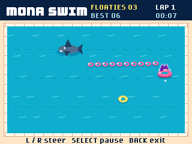

# Mona Swim

A pool party version of Snake for the GitHub Universe badge.

Mona swims in a pink ring and tows a growing train of floaties. Collect the
yellow rings while avoiding the pool edge, your own trail, and the sharks.

Gameplay captured directly from a Universe 2026 badge's 320x240 framebuffer.

- Hold Left / Right to steer relative to Mona's swimming direction.
- Press Select to start, pause, resume, or play again.
- Press Back to return to the launcher. Home also uses the badge's normal exit.
- A white dot ahead of Mona shows her swimming direction.

Every five pickups increases the speed. A second shark arrives at five pickups
and a third at ten. Sharks patrol their marked lanes and bounce at the pool
edges. Each new shark flashes for 1.8 seconds before it can bite.

Best scores use the badge's `State` storage under `mona_swim`. The app works
offline. It uses a copy of the existing Flappy Mona sprite sheet; the pool,
floaties, and sharks are drawn in code.

The launcher discovers this folder automatically. `apps/menu/app.py` also places
it after Snake and supplies its shark-fin icon without changing compiled icons.
The included 48x48 `icon.png` uses the same fin-and-waves design for launchers
that load app icons.

After copying files in USB storage mode, safely eject BADGER and restart the
badge to reload the launcher. Open **Mona Swim**.

## Validation

The author has played the game successfully on a physical badge. Additional
scripted checks ran the installed app on Universe 2026 hardware with native
graphics and logical button inputs in both firmware display rotations. These
covered starting, steering, pausing and resuming, pickups, shark progression,
game over, restarting, Back exit, and a best-score save/load round trip. The
original best score was restored after testing.

Scripted inputs do not verify physical touch sensing or automatic rotation
when the badge is turned by hand.
