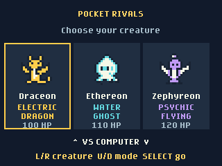

# Pocket Rivals

Pocket Rivals is a turn-based elemental battle game with three original pixel-art creatures, played against the computer or another badge.

## Play

Open **monster_battle** from the badge menu. Use **Left/Right** to choose
Draceon (Electric/Dragon), Ethereon (Water/Ghost), or Zephyreon
(Psychic/Flying). Use **Up/Down** to switch between **VS COMPUTER** and
**VS ANOTHER BADGE**, then press **Select**.

During battle, use the **direction pad** to choose one of four moves and
**Select** to use it. Against the computer, you act first and the opponent
responds automatically.
Each action animates and displays its result. Press **Select** to advance
after a short pause, or wait for the next action.

| Move | Effect |
| --- | --- |
| Quick Hit | 15 base damage, always hits. |
| Spark Lance / Tide Pulse / Mind Wave | 19 base damage, always hits, uses the creature's first type. |
| Dragon Rush / Haunt / Sky Dive | 28 base damage, 75% accuracy, uses the creature's second type. |
| Mend | Restores up to 28 HP; two uses per creature per battle. |

Damage varies by up to two points before elemental modifiers. Attacks are
checked against both of the opponent's types. Strong matchups deal 2x damage
per weak type; resisted matchups deal half damage per resistant type.
For example, Draceon's electric attack is strong against both rivals,
Ethereon's ghost attack is strong against Zephyreon's psychic type, and
Zephyreon's flying attack is resisted by Draceon's electric type. There are
no same-type attack bonuses, critical hits, status effects, or speed stats;
against the computer, the player always acts first.

At the result screen, press **Select** for a fresh battle or **Up** to
choose another creature. **Back** also leaves an idle battle for creature
selection. **Home** returns to the badge menu at any time.

## Battle another badge

Both badges need Pocket Rivals installed. Choose **VS ANOTHER BADGE**, press
**Select**, and hold the two badges back to back until the progress bar
fills. You can still change creature with **Left/Right** while waiting, or
press **Up** to return to creature choice. Each badge then shows its
rival's name and creature: press **Select** to accept or
**Back** to decline. The challenge expires after 20 seconds.

Both players pick a move each turn; the screen shows *Waiting for rival...*
until the other badge has chosen. **Mend** always goes first; otherwise a
coin flip decides who acts first. The connecting badge that acts as host
picks a random seed for each battle and sends the turn order, so both
badges calculate identical damage and misses. At the result screen, both
players press **Select** for a rematch, or **Up** to leave. **Back** during
a battle also forfeits and returns to pairing.

The move-selection footer shows the selected move's power, accuracy, or
remaining healing uses. Battles are not saved; reopening starts fresh.

## Requirements

GitHub Universe 2026 firmware. No Wi-Fi, credentials, extra hardware, or
external assets are required. Badge battles use the firmware's
`badgeware.link` badge-to-badge link (the same one Pong uses); on firmware
without it, the app shows a notice and computer battles still work.

## License and artwork

The code, creature designs, pixel art, and icon were created for this app
and are contributed under this repository's MIT License. No third-party
character sprites, logos, music, or external fonts are bundled.

## Checking the app

Run `python -m unittest discover -s tests -p "test_monster_*.py"` from
the repository root for battle-rule and badge-link protocol checks (the
link is simulated with fake paired badges). Try the app in the Badge
Simulator, including a complete battle, healing, rematches, and inverted
orientation. The simulator cannot pair badges, so badge battles must be
tested on two physical badges. Badge-to-badge battles have been tested by
the contributor on Universe 2026 hardware. Additional hardware checks:
the menu icon, all controls, both orientations, Home/reopen, and Up after
a battle to return to creature choice.
