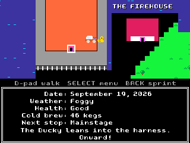

# The Octocat Trail

Lead the Studio party across a Fort Mason-inspired venue to the GitHub Universe Mainstage in an original, GitHub-themed homage to classic Apple II trail games.

The GitHub Ducky pulls the wagon, Mona rides up front, and Markus, Mona, Cameron, Hubot and Tufty walk about 2,000 steps from the Gatehouse (`git init`) to the Festival Pavilion Mainstage. The app runs in 320x240 HIRES mode and needs no network, Wi-Fi or `secrets.py`.

## Usage

Open **The Octocat Trail** from the menu. The title screen offers:

- **Continue your run**: resume the saved run, shown with its step count.
- **Start a new run**: choose a role, read the party card, then outfit the wagon at the Gatehouse General Store.
- **Visit the graveyard**: browse tombstones from your own runs and those beamed in by friends.
- **Monitor**: switch between the Color and Green Apple II monitors. **MENU** swaps the monitor on any screen.
- **Dark Mode Camp sensor**: turn the ambient light trigger on or off.
- **Learn how to play**: five short help pages.

| Screen | Controls |
| --- | --- |
| Title and menus | UP/DOWN choose, SELECT go, BACK return; LEFT/RIGHT also toggle the Monitor and sensor rows |
| Walking the venue | D-pad walk, SELECT open the menu (or the river screen at a dock), BACK turbo sprint |
| Store | UP/DOWN choose, RIGHT or SELECT buy a pack, LEFT return this visit's purchases, BACK leave (to the title before you set out) |
| Bug & AI Slop Hunt | D-pad walk Mona, SELECT throw an LGTM Stamp the way she faces, BACK stop |
| Dark Mode Camp | SELECT or BACK break camp |
| Tombstone | LEFT/RIGHT choose an epitaph, SELECT beam it, BACK title |
| Victory | SELECT beam your score, BACK title |
| Graveyard | LEFT/RIGHT browse, SELECT beam the shown tombstone, BACK title |

### Roles

| Role | Copilot Credits | Score | Perk |
| --- | --- | --- | --- |
| Creative Director @wmarkus | 1,600 | x1 | Deep pockets for a comfortable run. |
| Staff Rustacean @mona | 1,000 | x2 | Every Hotfix Patch also heals the party by 10. |
| ATC Control Lead @kdaigle | 600 | x3 | River deploys are 40% safer. |

### Supplies and stores

- **Copilot Credits** pay for everything, including Copilot ferries.
- **Cold Brew Kegs** keep the party going. Running dry costs health every day.
- **LGTM Stamps** are hunt ammo, and two of them steady a river deploy.
- **Hotfix Patches** repair broken CI and revert Friday force-pushes.

The Gatehouse charges base prices. The GitHub Shop adds 25%, the Makerspace Parts Counter adds 50%, and the Firehouse Supply Locker sells only Hotfix Patches at a 60% markup. The wagon carries at most 500 kegs, 300 stamps and 9 patches.

### The venue

The map is an original top-down tile map inspired by the Fort Mason Center campus: the Gatehouse, Landmark Buildings A to E, the Firehouse, the Great Meadow and three piers. The direct trail runs Gatehouse, GitHub Shop, Merge Conflict River, Gateway Pavilion Makerspace, DNS Propagation Rapids and the Festival Pavilion Mainstage. Side trips pay off:

- **Open Source Zone, GitHub Central, Expert Center, Career Corner and Cowell Theater** each give a one-time gift and add points to your score.
- **The Firehouse (Hotfix HQ)** heals the party by 15 and cures illness, at most once every 5 days.
- **The Great Meadow** is the best hunting ground.

Every step passes time and drinks cold brew. Set the pace (Sustainable, Crunch or Death March) and rations (Nitro, Drip or Decaf) from the menu. The menu also has the wagon, the venue map, camp, attendee tips, the store at stores, the hunt, a turbo sprint and Save and quit.

### Production Deployments

The piers sit across open water. At **Merge Conflict River** and **DNS Propagation Rapids**, choose how to cross:

- **YOLO deploy (ford)**: free, but risky when the diff is deep.
- **Ship with 2 LGTMs**: spend two LGTM Stamps to lower the gangway.
- **Ask Copilot (ferry)**: the safest crossing; it costs 40 credits at the river or 70 at the rapids, plus a 1 to 3 day wait.
- **Wait for review**: lose a day while the depth changes.
- **Plan it out**: open the menu without crossing.

### Bug & AI Slop Hunt

Spend a day hunting for cold brew bounties. You have 30 seconds and at most three stamps in flight. Bugs take one stamp and pay 6 kegs; AI slop blobs take two and pay 25. Trees, bushes and rocks block both Mona and her stamps, and you can haul at most 100 kegs back to the wagon.

### Trail events

Expect node_modules dysentery, AI Slop Fever, YAML indentation fatigue, merge-queue migraines, broken CI, Dependabot caravans, typosquatters, stale READMEs, Python 2 dependencies, Copilot shortcuts, the GitHub unicorn, and Force-pushed to main on Friday. When the whole party is lost, choose an epitaph for the tombstone.

## Hardware

Every hardware feature is optional and guarded, so the app also runs in the Badge Simulator:

- **IMU turbo sprint**: shake the badge three times within 1.2 seconds for a 6-day sprint at 7/4 speed. It drinks 1.5x the cold brew, costs 2 health a day and then needs 8 days to cool down. Detection uses changes in acceleration magnitude, so it works whichever way up the badge is. BACK while walking also sprints.
- **Ambient light Dark Mode Camp**: the phototransistor on GPIO43/ADC3 (`badge.light_level()`, falling back to `machine.ADC(43)`) is compared with the room's recent brightness. When it falls below 30% of that level for 1.2 seconds, the party makes camp and rests, and it breaks camp when the light returns. Turn the sensor off on the title screen, or choose **Make camp and rest** from the menu for a manual camp of up to 3 days.
- **IR beaming**: SELECT on a tombstone, the graveyard or the victory screen beams it over NEC infrared on address `0x54` (transmit on GPIO16, receive on GPIO17 through `badgeware.ir`). A beam repeats a 9-byte checksummed packet three times and takes about 2 seconds. Beams only reach badges that are running The Octocat Trail at the time. Received tombstones join the graveyard and received victories appear as a notice. Without IR, the beam is simulated.
- **Case lights** chase while beaming and on victory, flicker at camp and pulse while sprinting.

In the Badge Simulator the IMU and light sensor are static and IR is unavailable, so use BACK to sprint, the menu to camp and the simulated beam.

## Saved data

The app saves to `badgeware.State` under `octocat_trail`. It stores the best score, monitor and sensor settings, up to 12 tombstones, run, victory and beam counts, and the run in progress. A run autosaves at stops, rivers and stores, when the pace or rations change, every 15 days, when breaking camp and on exit.

## Credits

- The Octocat Trail is an original, unofficial homage to classic trail games. It is not affiliated with or endorsed by the owners of The Oregon Trail, and all of its art, text and code are original.
- The venue map is inspired by the public layout of Fort Mason Center in San Francisco. It is not an official venue map.
- The Green monitor was inspired by the phosphor palettes in Cameron Foxly's [Ascii-Motion](https://github.com/CameronFoxly/Ascii-Motion). It is an independent implementation and includes no Ascii-Motion code.
