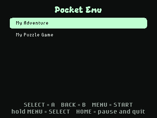

# Pocket Emu

Play classic 8-bit handheld games from cartridges you own on the badge.

Pocket Emu runs [Peanut-GB](https://github.com/deltabeard/Peanut-GB), an
emulator written in C, as a compiled MicroPython native module (`gbcore.mpy`).
Games run at full speed, scaled 1.5x to fill the screen, with optional colour
palettes. The badge has no speaker, so there is no sound.

## Adding games

No games are included. Use ROM files (`.gb`) that you have dumped from
cartridges you own.

1. Put the badge in USB Disk Mode (open **Mass Storage**, or double-tap RESET).
2. Copy your `.gb` files into `apps/pocket_emu/roms/` on the `BADGER` drive.
3. Eject the drive and open **Pocket Emu** from the menu.

If there is one game, it starts straight away; with several, pick one from the
list. A typical game is 1 MB or less, and the badge has room for several.

Monochrome-era games and dual-mode games that also run on monochrome hardware
work. Colour-only games do not.

## Controls

| Badge | Handheld |
| --- | --- |
| Direction buttons or touch pad | D-pad |
| SELECT | A |
| BACK | B |
| MENU (tap) | START |
| MENU (hold) | SELECT |
| HOME | Pause menu |

The pause menu changes the colours (automatic per-game colours, classic green,
grey), the pixel style (sharp, smooth, original size) and the speed (normal or
2x fast forward). Choose **Save and quit** to return to the badge menu.

## Saves

Battery saves are written to `/state/pocket_emu/<game>.sav` on the badge about
a second after the game writes them; **SAVED** flashes in the corner. To bring
a save from another emulator, copy it next to the game as
`roms/<same name as the game>.sav`; the app loads it the first time the game
starts.

## Rebuilding the emulator core

`gbcore.mpy` is built from [`tools/pocket_emu/`](../../../tools/pocket_emu/).
See that README to rebuild it after changing the C code or the firmware's
MicroPython version.
