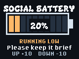

# Social Battery

Social Battery shows your current energy for socialising and helps you signal when you need a break.

## Usage

Open **Social Battery** from the badge menu and show the screen to others.
Press UP to add 10% or DOWN to subtract 10%; the level stays between 0% and
100%. Low levels display a gentle request for a shorter chat or a break, and
0% says you are not up for chatting. The chosen level is saved when it changes
and restored when you reopen the app. Press HOME to return to the menu.

No Wi-Fi, extra hardware, or secrets are required. The value is stored locally
in the badge's `/state/` filesystem, not on the BADGER USB drive.

## Install

Download the `social_battery` folder, including `__init__.py` and `icon.png`.
Put your Universe 2026 badge in USB Disk Mode and copy the folder into
`BADGER/apps/`. Safely eject BADGER so the badge restarts into its menu.
Do not copy the app to the `RP2350` firmware bootloader drive. See the
[USB guide](../../../hardware/USB_SERIAL.md) for the full procedure.

The stock event menu may show a generic tile even when `icon.png` is present.
The [menu icon guide](../../../.github/skills/hyb26-skill/references/menu-icons.md)
explains the optional patch needed to display the custom battery icon.

## Screenshot

Captured in the browser simulator at the badge's 160x120 logical resolution.
