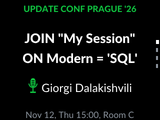

# Speaker

Shows your conference talk details plus scannable QR codes for the session, sample code and LinkedIn.

## Usage

| Control | Action |
| --- | --- |
| Right / Down | Next screen |
| Left / Up | Previous screen |
| Select | Switch between before and after the talk |
| Home | Back to the menu |

Screens: talk details, then QR codes for the session page, sample code and LinkedIn, each with Mona beside it. The dots on the right edge show which screen you're on.

After your talk, press **Select**. The main screen shows `AFTER_TALK` ("Ask me about my talk") instead of the date and room, and the sample code QR becomes the first screen after it. Press Select again to switch back.

The screen never turns off. After 30 seconds without a touch it dims from 100% to 70% and Mona holds still. The first touch on a dimmed screen only brightens it. Leaving the app restores the brightness set in Settings.

## Make it yours

1. In the **Settings** app, fill in **Contact Name** and **LinkedIn Profile**. The app shows your name, and builds the LinkedIn QR code from a full URL, a `linkedin.com/in/...` address or just your handle.
2. Add your talk details. Open the app in the [badger.github.io editor](https://badger.github.io/editor) (**Connect badge**, then **Choose badge app**), edit the block at the top of `__init__.py`, and select **Upload**:
   - `CONFERENCE`, `TITLE` (one string per line), `WHEN` and `AFTER_TALK`.
   - The URLs in `PAGES`. A QR screen with a blank URL is hidden, so you can leave out any you don't need.
   - `AFTER_ORDER`: the screen order after the talk.

To keep your details separate from the code, put the same settings in a `talk.py` file next to `__init__.py` instead. Anything set there wins.

The app draws at 320×240 in Lato. Keep each title line short enough to fit 320 px at 30 px text. Power settings are under `# --- Power`.
