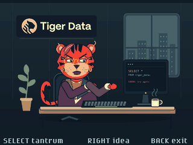

# Tiger Data

Tiger Data animates an office tiger typing, throwing a keyboard tantrum, and having a bright idea.

The animation loops automatically through a 13-second sequence at a target
12 frames per second on the Universe 2026 badge's 320x240 display.

## Controls

| Control | Action |
| --- | --- |
| Select | Jump to the keyboard tantrum. |
| Right | Jump to the bright idea. |
| Back | Return to the launcher. |
| Home | Use the firmware's normal launcher shortcut. |

Controls use the firmware's logical button actions, including when the badge
is upside down.

## Installation and requirements

Copy the complete `tiger_data` directory to `/system/apps/tiger_data` on a
Universe 2026 badge using USB Disk Mode. Keep all 156 PNG files in
`assets/frames/`; the app decodes one frame at a time to limit memory use.
No Wi-Fi, credentials, extra hardware, or persistent state are required.

If a frame cannot be loaded, the app shows a message and keeps Back available.
Check that the complete app directory was copied, then reopen the app.

## Screenshot

## Artwork

The editable artwork generator and source SVG are in
[`tools/tiger_data/`](../../../tools/tiger_data/). The Tiger Data logo is
credited to Tiger Data.

To regenerate the animation, install Pillow in a desktop Python environment
and run `python tools/tiger_data/make_frames.py` from the repository root.
The generator uses the macOS supplemental Andale Mono font; it runs on the development
computer, not on the badge. The generated PNG frames are included, so users
do not need Pillow or desktop fonts to run the app.
