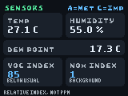

# SHT41 and SGP41 sensor dashboard

A one-page environmental dashboard for the **GitHub Universe 2025 badge**.
Connect an SHT41 and an SGP41 to the external Qw/ST I2C bus. The app displays
temperature, relative humidity, calculated dew point, VOC Index and NOx Index.
It needs no network connection, account or secret.

## Compatibility

Tested on a physical GitHub Badger with RP2350 and the Universe 2025
MonaOS/Badgeware runtime. The firmware reported MicroPython 1.26.0 through
`sys.implementation`, with the older `v1.14-5485.gddae88e91.dirty` boot banner.
The display uses the 160x120 logical drawing surface.

The 2026 runtime uses different graphics and input APIs. **This app is not
claimed to support the 2026 badge or every future badge.** Sensor protocol
code is independent of the graphics API, but the UI must be ported and the
native module's architecture/ABI checked for another runtime.

## Installation

Copy this complete directory to `/system/apps/sensor_dashboard` using the
badge's USB storage mode. On Windows the BADGER drive exposes it as
`F:\apps\sensor_dashboard`. Return to normal mode and launch the app.
Do not overwrite firmware, `main.py`, `secrets.py` or the menu.

The app uses the board's `I2C_SDA` and `I2C_SCL` aliases on I2C controller 0
at 100 kHz. On the tested badge these aliases mapped to GPIO4 and GPIO5.
SHT41 is expected at 0x44; SGP41 at 0x59. Other bus devices are left alone.
The exact breakout-board connector pinout and input-voltage rating must be
verified for the boards being connected.

## Controls and display

- **A:** Celsius, the default on every launch.
- **C:** Fahrenheit for temperature and dew point.
- **Home:** return through the existing launcher.

Relative humidity and gas indexes do not have an imperial conversion.
The header permanently shows `A=Met C=Imp`. Long gas captions scroll inside
their cards. A compact native pixel font keeps captions and footer readable.
Missing sensors and I2C/CRC errors replace affected readings rather than
showing stale data as fresh.

## What the gas indexes mean

The SGP41 supplies raw signals, not concentrations. This app runs Sensirion's
unmodified fixed-point Gas Index Algorithm 3.2.0 once per successful one-second
gas sample. Outputs range from 1 to 500. VOC's learned background is around
100; NOx's background is around 1. Captions compare against those offsets,
not arbitrary raw-signal thresholds.

These are **relative indexes, not ppm, CO2, regulatory AQI or a safety alarm**.
They cannot establish that air is safe to breathe.

In normal operation, startup conditions the sensor for approximately nine
seconds, below the manufacturer's maximum ten seconds. Its indexes then remain
in the algorithm's approximately 45-second blackout; the screen shows **Warming up**.
The default learning constants are 12 hours, so the baseline continues adapting.
Reopening the app starts fresh. Failed measurements or substantial sampling
gaps reset the index state. Nothing is written to flash for learned-state
persistence.

The nine-second conditioning deadline takes priority over normal sampling,
including pending conversions and sensor-error states. Conditioning is marked
complete only after the normal measurement command receives a full I2C
acknowledgement. A failed transition also attempts heater shutdown. If both
commands fail, the original timer and expired-window latch remain active so
subsequent updates retry without waiting for the one-second sampling cycle
or restarting conditioning after tick wrap.
If compensation is unavailable and shutdown fails, SHT41 recovery continues
without discarding the gas deadline or cancelling its pending conversion.

Failed heater shutdown, including a short acknowledgement, does not clear the
conditioning state. Recovering SHT41 readings therefore cannot start a fresh
nine-second window unless shutdown actually succeeded. Errors remain visible
and are printed to the serial console. If the I2C bus remains unreachable,
software cannot confirm or guarantee physical heater shutdown.

Temperature/humidity compensation uses the current SHT41 readings. The SHT41
is sampled in high-precision mode with its heater off. CRC-8 checks protect
both sensors' replies, and SGP41 heater shutdown is attempted on app exit;
failed shutdown commands are reported rather than treated as successful.
Dew point uses the Magnus approximation with constants 17.62 and 243.12.

## Native module and licensing

`_gas_index.mpy` is a small ARMv6-M native module built against MicroPython
v1.26.0. It was imported and used on the tested badge without replacing its
firmware. It requires a compatible native-module ABI; incompatible or missing
modules are reported as **Index error** while the temperature readings remain
available.

Sensirion's BSD-3-Clause notice is retained in `LICENSE.gas-index` and in
the vendored source under `badge25/tools/native/vendor/`. The wrapper, UI and
tests follow this repository's MIT license. Upstream versions and commit hashes
are recorded in `badge25/tools/native/SOURCES.txt`.

To rebuild with the ARM GCC toolchain, newlib, GNU Make, and Python packages
`pyelftools` and `ar`:

```bash
git clone --depth 1 --branch v1.26.0 https://github.com/micropython/micropython.git ../micropython
make -C badge25/tools/native ARCH=armv6m
cp badge25/tools/native/_gas_index.mpy badge25/apps/sensor_dashboard/_gas_index.mpy
python3 badge25/tools/build_tiny_font.py
```

The native module contains no floating-point approximation of our own: the
fixed-point implementation and its defaults are unchanged.

## Validation

```bash
python3 -m unittest discover -s badge25/tests -p 'test_sensor_dashboard.py' -v
```

Synthetic tests cover sensor CRCs, compensation, conditioning limits, timing,
failed transitions and shutdowns, short acknowledgements and recovery across
tick wrap,
missing devices, unit controls, clipping, scrolling and font parsing. The
display and numeric indexes were also checked by the owner on the physical
2025 badge. The screenshot below is a deterministic rendering of the app with
representative values, not a calibration result.



## References

[SHT4x protocol](https://github.com/Sensirion/embedded-i2c-sht4x),
[SGP41 protocol](https://github.com/Sensirion/embedded-i2c-sgp41),
[Gas Index Algorithm](https://github.com/Sensirion/gas-index-algorithm),
[VOC interpretation](https://sensirion.com/resource/application_note/voc_index),
[NOx interpretation](https://sensirion.com/resource/application_note/nox_index).
